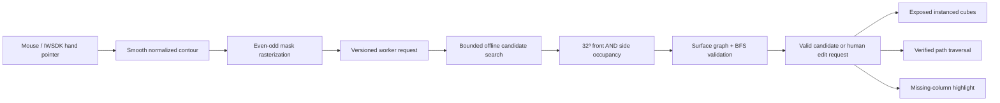

# Implemented architecture
The official generated Vite plugin reads iwsdk.config.json and supplies virtual:iwsdk-project to World.create. Assets are deterministic parentless prototypes shared by runtime/editor. CoCreateSystem is an IWSDK entity-component system (ECS) system; spatial objects use RayInteractable and SDK pointer events. All runtime Three imports come from @iwsdk/core.

Front is XY; side is ZY. Each pixel maps to a voxel column. Y increases upward. Grid dimensions 32³, physical cell sizes x=.04, y=.02, z=.02 meters. Volume lower corner is (-.84,.63,-1.87). Rendering and validation read the same occupancy array. Interior voxels are omitted from rendering, occupancy preserved.

Contours: clamp normalized coordinates, smooth samples with EMA .7, spacing .004, cap 2048 points, implicit closure, even-odd fill at pixel centers. Fewer than 6 pixels is rejected as empty. Crossings have deterministic parity semantics.

Planner searches up to 24 candidates with an 800ms worker budget: 3 deck heights, 4 depth widths, 2 thicknesses. Score is 100000 minus occupied voxel count and a 1000-per-cell penalty for distance from a preferred depth derived from the human silhouette’s occupied area/span. Valid drawings of different thickness therefore change LUMA’s depth choice; validity always dominates candidate selection. Invalid score measures reachable surface exploration. Candidate attempts retain width, height, failures and score. No agent function mutates front pixels. Missing X is diagnosed from the human mask itself and highlighted by column. Search is deterministic absent a time-budget exit.

Validation is an intentionally discrete rigid-light puzzle model, not structural engineering simulation. Standable cells require 3-cell floor thickness, a 3×5-cell XZ footprint, 6-cell head clearance, deck height within one cell of the banks, and bank-height endpoints. BFS visits surface cells with at most a 1-cell step. The banks anchor a continuous rigid deck; disconnected floating structures cannot pass. The 0.12×0.10m footprint and 0.12m headroom conservatively enclose the 0.09m traveler.

Worker responses are accepted only at current revision. New input/reset invalidates prior work. 2.5s watchdog terminates/recreates a stuck worker. Traversal is paused on visibility loss. Errors give recoverable guidance. Listeners, textures and worker are registered for teardown. Dynamic geometry is a bounded persistent InstancedMesh.

StrategyProvider supports OfflineStrategyProvider and the asynchronous CloudStrategyProvider. The app’s optional cloud path requests only a strategy/explanation, then runs authoritative geometry validation in the existing worker. server/cloud.mjs supports Vultr/OpenAI with server-only credentials, strict schema validation, consent, bounded requests and fallback. No frontend key setting exists. Level 3 is experimental behind ?level3=1; it checks both path and overhead shelter, including the actual path footprint. See level3.md and optional-cloud.md.

## Review-driven journey and presentation
Four chapters are now the default sequence. Last Spark adds a validated voxel cost limit; failure cannot be fixed by rewriting the human mask. Workshop presets vary goals deterministically. The large facing depth panel mirrors S(z,y) for legibility; the perpendicular plane retains its true orientation. Neither changes the logical intersection. Contiguous exposed cubes remove inset seams, and deck candidates have at least three occupied cells of thickness.

Loop teaching is an animation only and never writes the user's mask. Open strokes remain visible and cannot silently become successful geometry. The optional recording hook captures only the app's WebAudio destination using MediaRecorder, never a microphone. Demo narration is generated locally with macOS Samantha and is not presented as LUMA speech.

Garden now supports additive human editing: each valid closed polygon is unioned with the existing F mask, and neither an open contour nor a tiny contour erases prior loops. This does not alter V=F&S or agent ownership. The taught lower guide spans floor rows 7–9, and the roof guide spans 16–17; separate loops leave the required headroom clear. Other chapters retain replacement editing for extension and resource trimming.

The current guide adds a small Garden inset margin while leaving the authoritative validator strict. Live preview reports closure/length only, not untested safety. Clear/Undo keep a visible acknowledgement during replanning. Input-source removal, pointer cancellation and immersive blur restore the previous committed mask/solid and require a retry rather than committing an interrupted stroke.

For legibility without hiding near hands, transparent board surfaces render after sparks; sparks do not write depth, and boards retain depth testing against opaque scene/hand geometry. Spatial settings/background render after boards. Desktop visibility also gates the perpendicular plane material. The finale keeps both silhouettes beside the verified structure and displays separate cyan/amber credits; its brief emission celebration respects Reduced motion.
